# Plan — fleet hardening in Pareto order (go-service-template)

**Created:** 2026-11-24 09:05 CET · Crush (pareto-planning pass) · basis:
[the TODO list](../../TODO_LIST.md) rows 1-31 (every row mapped), ROADMAP themes
1-5 (direction only, deliberately not scheduled here), the four status reports
under [docs/status/](../status/), [FEATURES.md](../../FEATURES.md), and the
21-report library audit under [docs/review/libs/](../review/libs/).

> This plan orders work; it does not re-scope it. Every row keeps its
> TODO_LIST ID as the source of truth. When a task ships, the row moves to
> CHANGELOG and this plan's table is not rewritten — the next plan supersedes
> it.

## 1. How to read this

| Layer | Unit                                       | Horizon         |
| ----- | ------------------------------------------ | --------------- |
| L1    | One focused work session, 30-100 minutes   | The table in §4 |
| L2    | One uninterrupted step, at most 12 minutes | The table in §5 |
| Phase | A dependency gate (P0-P5)                  | The graph in §3 |

Rules that make the estimate honest:

- A task is done when its evidence is written down (command output, file:line,
  or a green gate), not when the code compiles.
- Any task that exceeds its ceiling is split before it is started, and this
  file is updated in the same commit.
- Idle waiting (a CI run, a preset tag) is its own task so it never hides
  inside a coding estimate; it may sit below the 30-minute floor.
- An L1 estimate exceeds the sum of its L2 steps on purpose: the difference
  is verification, the commit, and switching cost.

## 2. What actually moves the needle

The backlog is 31 rows. Sorting them by adopter-visible risk gives three
slices that are worth naming explicitly, because the largest items are not the
most valuable ones.

### The 1% that delivers 51%

**T-4.1: push `master` and watch CI.** Twenty-five minutes, one push. The repo
carries three workflow jobs whose commands have _never executed in CI_ — one of
them (`nix-image`) contained an attribute path that does not resolve until the
2026-11-22 audit caught it. Everything else in this plan is a local proof until
CI reproduces it on a clean runner. Nothing else buys as much confidence per
minute.

### The 4% that delivers 64%

Adding the two items that own the remaining structural risk:

1. **T-4.1/T-4.2** — CI green (the external truth).
2. **T-23.1-T-23.3** — the two `go-appkit/preset` defects: `APPKIT_SECURITY=strict`
   silently degrades to Standard, and `NoDashboard` panics at boot because the
   preset never stamps the probe. Every adopter inherits both. Code-traced;
   only one has been reproduced. Fix lands upstream, so this slice is the
   template's credibility, not its own code.
3. **T-1.1-T-1.3** — the OCI image is built and structure-checked, never
   booted. The flagship deliverable ("images from Nix") is proven on paper.

### The 20% that delivers 80%

Those three slices plus the verification harness the template is missing:

- **T-2.1/T-2.2** dogfood a fresh clone (the adopter's actual first hour),
- **T-17.1/T-17.2** a repeatable probe script (the template's only
  quality-of-proof asset; its absence already produced an invalid probe run),
- **T-22.1/T-22.2** the appkit tuple refresh, blocked on `preset/v0.1.2`.

Six of thirty-one rows (20%) produce the adoption confidence; the rest is hygiene,
policy, and series integrity.

### The other 80% (to reach 100%)

- **P0 gate repair** — the audit corpus was committed unformatted, so
  `dprint check` is red today (row 31). It blocks every future gate run and is
  fixed with the formatter-order ritual, never a blind `dprint fmt`.
- **P0 completeness** — gitleaks, lint caching, events-tag build, templ-regen
  drift, darwin eval (rows 12, 13, 18, 3).
- **P3 template surface** — the repo's own seams are the least-tested code it
  ships: 0% statement coverage in `cmd/app`, `internal/app`, `views` (row 15),
  plus row 25's documentation/examples work.
- **P4 audit-series integrity** — 21 reports carrying ~1,116 citations, errata
  (row 26), mechanized gates (row 27), independent QC (row 28), discoverability
  (row 29), and upstream intake (row 30). High value for the _audit_, near-zero
  for an adopter until the findings land upstream.
- **P5 policy and hygiene** — the two owner decisions (rows 5, 6), the
  portability fix (row 10), upstream issue batches (rows 7, 8, 9, 20), small
  debts (row 21), precommit (row 14), the ADR (row 11).

## 3. Execution graph

Edges mirror the `Depends on` column in §4; a G-gate enters the graph as the
task that produces it (G1 = T-4.2, G2 = T-1.2).

```mermaid
flowchart TD
  subgraph P0["P0 - external truth: CI"]
    T311["T-31.1 format audit corpus"]
    T312["T-31.2 repair reflow findings"]
    T313["T-31.3 verify full gate"]
    T41["T-4.1 push and watch"]
    T42["T-4.2 fix CI fallout"]
    T121["T-12.1 gitleaks step"]
    T131["T-13.1 cache lint install"]
    T181["T-18.1 events tag build"]
    T182["T-18.2 templ drift check"]
    T31["T-3.1 darwin eval job"]
    T161["T-16.1 enumerate doc commands"]
    T162["T-16.2 command smoke check"]
  end

  subgraph P1["P1 - prove the artifact"]
    T11["T-1.1 choose runtime path"]
    T12["T-1.2 boot and probe image"]
    T13["T-1.3 checks.image-smoke"]
    T171["T-17.1 probe script"]
    T172["T-17.2 edge-case probes"]
    T21["T-2.1 fresh clone rename"]
    T22["T-2.2 renamed build and boot"]
    T191["T-19.1 systemd-run probe"]
    T192["T-19.2 watchdog assertions"]
  end

  subgraph P2["P2 - upstream preset"]
    T231["T-23.1 re-verify against HEAD"]
    T232["T-23.2 reproduce strict degradation"]
    T233["T-23.3 file issues"]
    T241["T-24.1 HealthOptions"]
    T242["T-24.2 DashboardOptions"]
    T243["T-24.3 HubOptions and NoTimeout"]
    T221["T-22.1 wait for preset tag"]
    T222["T-22.2 stamp ritual"]
  end

  subgraph P3["P3 - template surface"]
    T151["T-15.1 CLI test"]
    T152["T-15.2 config test"]
    T153["T-15.3 views test"]
    T251["T-25.1 README routing"]
    T252["T-25.2 validation example"]
    T253["T-25.3 comment drift"]
    T254["T-25.4 version stamping"]
  end

  subgraph P4["P4 - audit series"]
    T261["T-26.1 typo fixes"]
    T262["T-26.2 schema conformance"]
    T263["T-26.3 index errata"]
    T271["T-27.1 score reconciliation"]
    T272["T-27.2 citation sweep"]
    T273["T-27.3 conformance lints"]
    T281["T-28.1 QC batch 1-7"]
    T282["T-28.2 QC batch 8-14"]
    T283["T-28.3 QC 15-21 and cross-report"]
    T291["T-29.1 markdown index"]
    T292["T-29.2 glossary and changelog"]
    T301["T-30.1 group findings"]
    T302["T-30.2 upstream batch A"]
    T303["T-30.3 upstream batch B"]
  end

  subgraph P5["P5 - policy and hygiene"]
    T51["T-5.1 publish decision"]
    T52["T-5.2 wire publish"]
    T61["T-6.1 floor decision"]
    T62["T-6.2 apply ruling"]
    T71["T-7.1 reproduce dockerignore"]
    T72["T-7.2 file dockerignore issue"]
    T81["T-8.1 no-dockerfile proposal"]
    T91["T-9.1 analyzer go pin"]
    T111["T-11.1 Nix-OCI ADR"]
    T201["T-20.1 doctor scoping issue"]
    T202["T-20.2 erraudit vocabulary issue"]
    T211["T-21.1 isolate nix-hash-fix"]
    T212["T-21.2 state DB triage"]
    T213["T-21.3 small debts"]
    T141["T-14.1 precommit decision"]
    T101["T-10.1 dprint decision"]
    T102["T-10.2 dprint implementation"]
  end

  T311 --> T312
  T312 --> T313
  T41 --> T42
  T42 --> T121
  T42 --> T131
  T42 --> T181
  T42 --> T182
  T42 --> T31
  T161 --> T162
  T11 --> T12
  T12 --> T13
  T171 --> T172
  T12 --> T171
  T21 --> T22
  T12 --> T191
  T191 --> T192
  T231 --> T232
  T232 --> T233
  T233 --> T241
  T241 --> T242
  T242 --> T243
  T221 --> T222
  T151 --> T152
  T152 --> T153
  T151 --> T252
  T151 --> T254
  T261 --> T262
  T262 --> T263
  T263 --> T271
  T263 --> T291
  T291 --> T292
  T271 --> T272
  T272 --> T273
  T273 --> T281
  T281 --> T282
  T282 --> T283
  T283 --> T301
  T301 --> T302
  T302 --> T303
  T101 --> T102
  T101 --> T111
  T51 --> T52
  T61 --> T62
  T71 --> T72
  T72 --> T81
  T72 --> T91
  T201 --> T202
  T42 --> T11
  T42 --> T51
```

**Gates inside the graph**

| Gate | Meaning                                     | Unblocks                          |
| ---- | ------------------------------------------- | --------------------------------- |
| G0   | `docs-gates run .` green (already true)     | every commit                      |
| G1   | CI green on a pushed `master` (T-4.1/T-4.2) | P1/P3 trust; publish discussion   |
| G2   | Image boots and drains (T-1.2)              | publish work, stamp ritual claims |
| G3   | Preset tuple stamped and probed (T-22.2)    | claiming current appkit posture   |
| G4   | Audit series gates mechanized (T-27.x)      | QC (T-28.x) and intake (T-30.x)   |

## 4. L1 plan — 30-100 minute tasks

Sorted by importance, then impact, then effort. `Backlog` is the TODO_LIST
row (or `roadmap` for direction that is deliberately not scheduled).

| Rank | ID     | Task (30-100 min)                                                        | Backlog | Impact | Effort | Min | Depends on |
| ---- | ------ | ------------------------------------------------------------------------ | ------- | ------ | ------ | --- | ---------- |
| 1    | T-4.1  | Push `master` and watch the three CI jobs                                | 4       | High   | S      | 25  | —          |
| 2    | T-4.2  | Triage and fix any CI fallout (pins, v2 lint, nix-image)                 | 4       | High   | M      | 60  | T-4.1      |
| 2.1  | T-31.1 | Format the audit corpus in one atomic `dprint fmt` pass                  | 31      | High   | M      | 60  | —          |
| 2.2  | T-31.2 | Repair the F/spacing findings the reflow creates, re-run annotate        | 31      | High   | S      | 40  | T-31.1     |
| 2.3  | T-31.3 | Re-run the full gate and confirm the dprint step is green                | 31      | High   | S      | 25  | T-31.2     |
| 3    | T-23.1 | Re-verify both preset defects against appkit HEAD                        | 23      | High   | S      | 30  | —          |
| 4    | T-23.2 | Runtime-reproduce `APPKIT_SECURITY=strict` degradation                   | 23      | High   | M      | 45  | T-23.1     |
| 5    | T-23.3 | File the go-appkit issues with reproduction evidence                     | 23      | High   | M      | 40  | T-23.2     |
| 6    | T-1.1  | Choose the image-run path (local runtime vs CI runner)                   | 1       | High   | S      | 40  | G1         |
| 7    | T-1.2  | Load, run, probe and SIGTERM-drain the image                             | 1       | High   | M      | 45  | T-1.1      |
| 8    | T-1.3  | Write `checks.image-smoke` and wire it into CI                           | 1       | High   | M      | 90  | T-1.2      |
| 9    | T-2.1  | Fresh-clone this tree and run the documented rename                      | 2       | High   | M      | 40  | —          |
| 10   | T-2.2  | Build, boot and image-build the renamed copy                             | 2       | High   | M      | 45  | T-2.1      |
| 11   | T-17.1 | Write the dogfood probe script (port, stamp check, matrix, drain)        | 17      | High   | M      | 75  | T-1.2      |
| 12   | T-17.2 | Add bind-failure and drain-under-load cases to the probe                 | 17      | High   | M      | 50  | T-17.1     |
| 13   | T-22.1 | Watch for the `preset/v0.1.2` tag and confirm the tuple                  | 22      | High   | S      | 10  | —          |
| 14   | T-22.2 | Execute the stamp ritual plus dogfood probe when it tags                 | 22      | High   | M      | 60  | T-22.1     |
| 15   | T-24.1 | Add `HealthOptions` passthrough plus the boot-panic fix upstream         | 24      | High   | M      | 75  | T-23.3     |
| 16   | T-24.2 | Add `DashboardOptions` passthrough upstream                              | 24      | High   | M      | 60  | T-24.1     |
| 17   | T-24.3 | Add `HubOptions` and settle the SSE-vs-WriteTimeout pairing              | 24      | High   | M      | 60  | T-24.2     |
| 18   | T-18.1 | Prove `internal/events` compiles: `-tags events` build and vet in CI     | 18      | High   | S      | 30  | T-4.2      |
| 19   | T-18.2 | Add the templ-regen drift check to CI                                    | 18      | High   | S      | 45  | T-4.2      |
| 20   | T-26.1 | Fix the five `rg -rn` display typos in the audit series                  | 26      | High   | S      | 20  | —          |
| 21   | T-26.2 | Bring `cqrs-htmx.md` back to the series schema                           | 26      | High   | S      | 30  | —          |
| 22   | T-26.3 | Fix the index errata and stamp provenance in every report header         | 26      | High   | S      | 45  | T-26.2     |
| 23   | T-16.1 | Enumerate every command the living docs name                             | 16      | Medium | S      | 25  | —          |
| 24   | T-16.2 | Build the docs-command smoke check and wire it into the gate             | 16      | Medium | M      | 75  | T-16.1     |
| 25   | T-27.1 | Script the score reconciliation (inventory to score)                     | 27      | High   | M      | 60  | T-26.3     |
| 26   | T-27.2 | Script the citation sweep over the ~1,116 `path:line` tokens             | 27      | High   | M      | 75  | T-27.1     |
| 27   | T-27.3 | Add the verify-block and conformance lints to the series gate            | 27      | High   | M      | 50  | T-27.2     |
| 28   | T-28.1 | Independent QC of reports 1-7 (10 citations each, score recount)         | 28      | High   | M      | 60  | T-27.3     |
| 29   | T-28.2 | Independent QC of reports 8-14                                           | 28      | High   | M      | 60  | T-28.1     |
| 30   | T-28.3 | QC reports 15-21 plus the cross-report contradiction pass                | 28      | High   | M      | 60  | T-28.2     |
| 31   | T-30.1 | Group the upstream findings by owning repo                               | 30      | High   | M      | 40  | T-28.3     |
| 32   | T-30.2 | File upstream issues, batch A (libraries with confirmed defects)         | 30      | High   | M      | 75  | T-30.1     |
| 33   | T-30.3 | File upstream issues, batch B (capability gaps and routing tags)         | 30      | High   | M      | 75  | T-30.2     |
| 34   | T-3.1  | Add the darwin eval job (or `flake check --all-systems`) to CI           | 3       | High   | S      | 45  | T-4.2      |
| 35   | T-15.1 | Test `cmd/app` CLI wiring                                                | 15      | Medium | M      | 50  | —          |
| 36   | T-15.2 | Test `internal/app` config load and composition                          | 15      | Medium | M      | 50  | T-15.1     |
| 37   | T-15.3 | Test the `views` page                                                    | 15      | Medium | S      | 30  | T-15.2     |
| 38   | T-19.1 | Probe the systemd path with a transient unit                             | 19      | Medium | M      | 50  | G2         |
| 39   | T-19.2 | Assert sd_notify READY, watchdog pings and STOPPING                      | 19      | Medium | M      | 45  | T-19.1     |
| 40   | T-25.1 | Add the README "service or web app?" routing box and adopter pointers    | 25      | Medium | S      | 45  | —          |
| 41   | T-25.2 | Add the POST validation example plus a rendered-error-shape test         | 25      | Medium | M      | 75  | T-15.1     |
| 42   | T-25.3 | Fix the events/`nolint` comment drift and add the cmdguard contract test | 25      | Medium | S      | 30  | —          |
| 43   | T-25.4 | `pkg/version` VCS stamping plus the conditional-demo wrap                | 25      | Medium | M      | 60  | T-15.1     |
| 44   | T-29.1 | Add the markdown index and per-score applicable-row counts               | 29      | Medium | S      | 45  | T-26.3     |
| 45   | T-29.2 | Glossary entries, CHANGELOG entry, screenshot of the index               | 29      | Medium | S      | 50  | T-29.1     |
| 46   | T-10.1 | Decide the committed `dprint.json` form (remote URLs vs bundle)          | 10      | Medium | S      | 25  | —          |
| 47   | T-10.2 | Implement it and prove regeneration does not undo it                     | 10      | Medium | M      | 60  | T-10.1     |
| 48   | T-12.1 | Add the gitleaks CI step                                                 | 12      | High   | S      | 35  | T-4.2      |
| 49   | T-13.1 | Cache the `go install golangci-lint` step                                | 13      | Low    | S      | 30  | T-4.2      |
| 50   | T-11.1 | Write the Nix-OCI ADR                                                    | 11      | Low    | S      | 45  | T-10.1     |
| 51   | T-5.1  | Owner decision recorded: publish path                                    | 5       | High   | S      | 15  | G1         |
| 52   | T-5.2  | Wire the chosen publish path                                             | 5       | High   | M      | 60  | T-5.1      |
| 53   | T-6.1  | Owner decision recorded: Go floor shape                                  | 6       | Medium | S      | 15  | —          |
| 54   | T-6.2  | Apply and document the floor ruling                                      | 6       | Medium | S      | 30  | T-6.1      |
| 55   | T-7.1  | Reproduce the `.dockerignore` regeneration                               | 7       | Medium | M      | 35  | —          |
| 56   | T-7.2  | File the BuildFlow `.dockerignore` issue                                 | 7       | Medium | M      | 35  | T-7.1      |
| 57   | T-8.1  | Draft the positive `no-dockerfile` upstream proposal                     | 8       | Low    | M      | 45  | T-7.2      |
| 58   | T-9.1  | Check BuildFlow's Go pin for the analyzer mismatch                       | 9       | Low    | S      | 30  | T-7.2      |
| 59   | T-20.1 | File the doctor-scoping upstream issue                                   | 20      | Low    | M      | 40  | —          |
| 60   | T-20.2 | File the erraudit-vocabulary upstream issue                              | 20      | Low    | S      | 30  | T-20.1     |
| 61   | T-21.1 | Isolate `nix-hash-fix` and record the result                             | 21      | Low    | S      | 25  | —          |
| 62   | T-21.2 | Triage the 1.06 GB buildflow state DB                                    | 21      | Low    | M      | 40  | —          |
| 63   | T-21.3 | Close the small debts (`APP_LOG_LEVEL`, upgrade, profile-io, token)      | 21      | Low    | S      | 50  | —          |
| 64   | T-14.1 | Decide and document the pre-commit hook story                            | 14      | Low    | S      | 30  | —          |

**Coverage check:** TODO rows 1-31 are each served by at least one task above
(rows 1-27 directly; row 28 by T-28.x; row 29 by T-29.x; row 30 by T-30.x;
row 31 by T-31.x). ROADMAP themes 1-5 stay out of this plan by design: they are
direction, not work.

## 5. L2 plan — at most 12 minutes per step

Every step is independently verifiable. `Parent` is the L1 task it belongs to.

### P0 — external truth

| ID     | Step (<=12 min)                                                      | Min | Parent |
| ------ | -------------------------------------------------------------------- | --- | ------ |
| 31.1.1 | Record HEAD and the two reflow-sensitive files as the baseline       | 8   | T-31.1 |
| 31.1.2 | Run `dprint fmt` over the audit corpus and the fleet status report   | 10  | T-31.1 |
| 31.1.3 | Read the reflow diff for content loss, not just padding              | 12  | T-31.1 |
| 31.2.1 | Repair `go-appkit.md:73` by rejoining the item whole                 | 12  | T-31.2 |
| 31.2.2 | Repair `go-sse.md:53` the same way                                   | 12  | T-31.2 |
| 31.2.3 | Re-run annotate and the row gate over the touched files              | 10  | T-31.2 |
| 31.3.1 | Run `buildflow --build-mode full` and read the dprint step verdict   | 12  | T-31.3 |
| 31.3.2 | Commit the formatting as its own change, citing this row             | 8   | T-31.3 |
| 4.1.1  | Confirm the tree is clean and the gate is green before pushing       | 5   | T-4.1  |
| 4.1.2  | Push `master` and capture the run URL                                | 5   | T-4.1  |
| 4.1.3  | Watch all three jobs and record the conclusion per job               | 10  | T-4.1  |
| 4.2.1  | Read each failing log and name the failing step                      | 12  | T-4.2  |
| 4.2.2  | Fix the first failure class (pins or lint install)                   | 12  | T-4.2  |
| 4.2.3  | Fix the second class (nix-image or Go version)                       | 12  | T-4.2  |
| 4.2.4  | Re-push and confirm green, then record the run ID                    | 12  | T-4.2  |
| 12.1.1 | Add the gitleaks step with a pinned action SHA                       | 10  | T-12.1 |
| 12.1.2 | Decide full-history vs diff scan and document the choice             | 8   | T-12.1 |
| 12.1.3 | Run it locally and confirm zero findings, then push                  | 12  | T-12.1 |
| 13.1.1 | Add `actions/cache` keyed on the golangci-lint version               | 10  | T-13.1 |
| 13.1.2 | Confirm the cache restores and the job time drops                    | 10  | T-13.1 |
| 18.1.1 | Add `go build -tags events ./...` to the build job                   | 6   | T-18.1 |
| 18.1.2 | Add `go vet -tags events ./...` and run both locally                 | 10  | T-18.1 |
| 18.1.3 | Push and record the job result                                       | 8   | T-18.1 |
| 18.2.1 | Check whether a pinned templ binary is available in CI               | 10  | T-18.2 |
| 18.2.2 | Add `templ generate` plus `git diff --exit-code views/`              | 12  | T-18.2 |
| 18.2.3 | Prove it fails on a deliberate drift, then revert the drift          | 10  | T-18.2 |
| 3.1.1  | Choose the darwin signal (`flake check --all-systems` vs eval job)   | 10  | T-3.1  |
| 3.1.2  | Add the job and avoid building Linux-only container outputs on macOS | 12  | T-3.1  |
| 3.1.3  | Push and record that the job skips or passes as intended             | 10  | T-3.1  |
| 16.1.1 | Grep every `nix build`, `go`, `curl`, `docker` line out of the docs  | 12  | T-16.1 |
| 16.1.2 | Classify each command: runnable, destructive, or needs a runtime     | 10  | T-16.1 |
| 16.2.1 | Write the runner with an allowlist and a timeout per command         | 12  | T-16.2 |
| 16.2.2 | Handle the commands that need a port or a container runtime          | 12  | T-16.2 |
| 16.2.3 | Wire it as a flake check and a gate step                             | 12  | T-16.2 |

### P1 — prove the artifact

| ID     | Step (<=12 min)                                                     | Min | Parent |
| ------ | ------------------------------------------------------------------- | --- | ------ |
| 1.1.1  | Inventory runtime options (podman from nix, CI runner, remote host) | 10  | T-1.1  |
| 1.1.2  | Pick one and record the decision plus its failure mode              | 10  | T-1.1  |
| 1.1.3  | Prove the runtime starts a trivial image                            | 10  | T-1.1  |
| 1.2.1  | Load `.#app-image` and capture its tag                              | 10  | T-1.2  |
| 1.2.2  | Run it on a free port and probe the endpoint matrix                 | 12  | T-1.2  |
| 1.2.3  | Assert `/version` is a git rev, not `dev`                           | 8   | T-1.2  |
| 1.2.4  | SIGTERM it and grep the five drain phases                           | 10  | T-1.2  |
| 1.3.1  | Sketch the check (build, load, run, probe, kill, assert)            | 12  | T-1.3  |
| 1.3.2  | Implement it against the derivation, not a hardcoded tag            | 12  | T-1.3  |
| 1.3.3  | Prove it fails on a bad expected version, then fix the expectation  | 12  | T-1.3  |
| 1.3.4  | Add it to CI and record the first green run                         | 12  | T-1.3  |
| 17.1.1 | Choose the script language and location (`scripts/probe.sh`)        | 8   | T-17.1 |
| 17.1.2 | Reserve a free port and write a non-self-matching kill              | 12  | T-17.1 |
| 17.1.3 | Assert the version stamp before trusting any endpoint               | 10  | T-17.1 |
| 17.1.4 | Cover `/healthz`, `/readyz`, `/startupz`, `/health`, `/`, 404, 405  | 12  | T-17.1 |
| 17.2.1 | Add the squatted-port path and assert the classified exit           | 12  | T-17.2 |
| 17.2.2 | Add an in-flight request and assert drain waits for it              | 12  | T-17.2 |
| 17.2.3 | Document the script in CONTRIBUTING as the probe ritual             | 8   | T-17.2 |
| 2.1.1  | `git archive` a clean copy into a temp dir                          | 8   | T-2.1  |
| 2.1.2  | Run the README rename and prove zero old-path matches               | 12  | T-2.1  |
| 2.1.3  | Rename `pname`, ldflags, unit and registry, then grep again         | 12  | T-2.1  |
| 2.2.1  | `go build` and race-test the renamed copy                           | 10  | T-2.2  |
| 2.2.2  | Boot the renamed binary and probe it                                | 12  | T-2.2  |
| 2.2.3  | Build the renamed image and record what the vendor hash does        | 12  | T-2.2  |
| 19.1.1 | Confirm systemd-run is available on this host                       | 6   | T-19.1 |
| 19.1.2 | Start a transient unit from the Nix binary                          | 12  | T-19.1 |
| 19.1.3 | Record READY in the journal and the unit state                      | 10  | T-19.1 |
| 19.2.1 | Watch `WatchdogSec=30s` pings for two intervals                     | 12  | T-19.2 |
| 19.2.2 | SIGTERM and assert STOPPING plus a clean unit exit                  | 12  | T-19.2 |

### P2 — upstream preset

| ID     | Step (<=12 min)                                                | Min | Parent |
| ------ | -------------------------------------------------------------- | --- | ------ |
| 23.1.1 | Re-read preset.go and security.go at appkit HEAD               | 12  | T-23.1 |
| 23.1.2 | Confirm the unstamped-probe panic path at HEAD                 | 12  | T-23.1 |
| 23.1.3 | Record file:line for both defects in a scratch note            | 8   | T-23.1 |
| 23.2.1 | Boot the template with `APPKIT_SECURITY=strict` and no origins | 10  | T-23.2 |
| 23.2.2 | Capture the response headers to prove the degradation          | 10  | T-23.2 |
| 23.2.3 | Write the minimal repro snippet for the issue                  | 12  | T-23.2 |
| 23.3.1 | Draft both issues with evidence and expected behaviour         | 12  | T-23.3 |
| 23.3.2 | File them and link the audit reports                           | 10  | T-23.3 |
| 24.1.1 | Add the `HealthOptions` field to preset Config                 | 12  | T-24.1 |
| 24.1.2 | Apply the options in `New` and stamp the version               | 10  | T-24.1 |
| 24.1.3 | Add a boot test with `NoDashboard` set                         | 12  | T-24.1 |
| 24.2.1 | Add `DashboardOptions` and pass them to `WithDashboard`        | 12  | T-24.2 |
| 24.2.2 | Test embedded SDK plus a custom CSS path                       | 12  | T-24.2 |
| 24.3.1 | Add `HubOptions` for last-event-ID replay                      | 12  | T-24.3 |
| 24.3.2 | Settle the SSE/WriteTimeout pairing in code or grammar docs    | 12  | T-24.3 |
| 22.1.1 | Watch `preset/v0.1.2` and confirm the tuple it requires        | 10  | T-22.1 |
| 22.2.1 | Update go.mod pins to the tagged tuple                         | 12  | T-22.2 |
| 22.2.2 | Bump the AGENTS stamp table and README line                    | 10  | T-22.2 |
| 22.2.3 | Run the dogfood probe and record it                            | 12  | T-22.2 |

### P3 — template surface

| ID     | Step (<=12 min)                                                 | Min | Parent |
| ------ | --------------------------------------------------------------- | --- | ------ |
| 15.1.1 | Add a `main_test` for `run()` with a fake argv                  | 12  | T-15.1 |
| 15.1.2 | Assert the three verbs are registered and `serve` is documented | 10  | T-15.1 |
| 15.2.1 | Test `Load()` defaults and env overrides                        | 12  | T-15.2 |
| 15.2.2 | Test the Rejection path for a bad env value                     | 12  | T-15.2 |
| 15.3.1 | Render the templ page and assert the version is interpolated    | 10  | T-15.3 |
| 15.3.2 | Assert the page is mounted at `/` only                          | 8   | T-15.3 |
| 25.1.1 | Draft the routing box (service vs web app vs library)           | 12  | T-25.1 |
| 25.1.2 | Add one adopter pointer per sibling library                     | 12  | T-25.1 |
| 25.2.1 | Add the POST example with `ResultHandlerWithValidation`         | 12  | T-25.2 |
| 25.2.2 | Add the rendered-error-shape test                               | 12  | T-25.2 |
| 25.3.1 | Fix the events-skeleton comment drift                           | 8   | T-25.3 |
| 25.3.2 | Fix the false exhaustruct nolint comment                        | 6   | T-25.3 |
| 25.4.1 | Decide `pkg/version` vs ldflags for `app version`               | 12  | T-25.4 |
| 25.4.2 | Implement the chosen stamping and test it                       | 12  | T-25.4 |

### P4 — audit series

| ID     | Step (<=12 min)                                              | Min | Parent |
| ------ | ------------------------------------------------------------ | --- | ------ |
| 26.1.1 | Fix the five `rg -rn` occurrences                            | 10  | T-26.1 |
| 26.1.2 | Grep the corpus for the same typo class                      | 8   | T-26.1 |
| 26.2.1 | Normalize the `cqrs-htmx.md` heading and status tokens       | 10  | T-26.2 |
| 26.2.2 | Remove body em dashes and re-run the vocabulary gate         | 10  | T-26.2 |
| 26.3.1 | Fix index findings 2 and 4 callouts                          | 12  | T-26.3 |
| 26.3.2 | Correct the Method sentence numbers                          | 10  | T-26.3 |
| 26.3.3 | Stamp consumer HEAD and auditor provenance in every header   | 12  | T-26.3 |
| 27.1.1 | Extract the inventory and score tables from the index        | 12  | T-27.1 |
| 27.1.2 | Write the reconciliation script and fail on a mismatch       | 12  | T-27.1 |
| 27.2.1 | Extract every `path:line` token with its repo qualifier      | 12  | T-27.2 |
| 27.2.2 | Check existence and that the line is in range                | 12  | T-27.2 |
| 27.2.3 | Run it and triage the first failure batch                    | 12  | T-27.2 |
| 27.3.1 | Lint H1 and front-matter conformance                         | 12  | T-27.3 |
| 27.3.2 | Lint the verify blocks for display-replace flags             | 10  | T-27.3 |
| 28.1.1 | Dispatch QC for reports 1-3                                  | 12  | T-28.1 |
| 28.1.2 | Dispatch QC for reports 4-7                                  | 12  | T-28.1 |
| 28.1.3 | Triage the first QC batch's findings                         | 12  | T-28.1 |
| 28.2.1 | Dispatch QC for reports 8-11                                 | 12  | T-28.2 |
| 28.2.2 | Dispatch QC for reports 12-14                                | 10  | T-28.2 |
| 28.2.3 | Triage the second batch                                      | 12  | T-28.2 |
| 28.3.1 | Dispatch QC for reports 15-18                                | 12  | T-28.3 |
| 28.3.2 | Dispatch QC for reports 19-21                                | 10  | T-28.3 |
| 28.3.3 | Cross-report contradiction pass                              | 12  | T-28.3 |
| 29.1.1 | Generate the markdown index from report headers              | 12  | T-29.1 |
| 29.1.2 | Add applicable-row counts beside each score                  | 12  | T-29.1 |
| 29.2.1 | Add the glossary entries and the CHANGELOG line              | 12  | T-29.2 |
| 29.2.2 | Capture the index screenshot and link it                     | 10  | T-29.2 |
| 30.1.1 | Group findings by owning repo from the routing tags          | 12  | T-30.1 |
| 30.1.2 | Rank each repo's findings by severity and reproducibility    | 12  | T-30.1 |
| 30.2.1 | Verify and file the go-appkit / go-health batch              | 12  | T-30.2 |
| 30.2.2 | Verify and file the dashboard / templ-components / sse batch | 12  | T-30.2 |
| 30.3.1 | Verify and file the cqrs / cmdguard / error-family batch     | 12  | T-30.3 |
| 30.3.2 | Verify and file the remaining library batch                  | 12  | T-30.3 |

### P5 — policy and hygiene

| ID     | Step (<=12 min)                                                | Min | Parent |
| ------ | -------------------------------------------------------------- | --- | ------ |
| 5.1.1  | Write the two publish options and their operational cost       | 10  | T-5.1  |
| 5.1.2  | Get the owner call and record it in ROADMAP open questions     | 8   | T-5.1  |
| 5.2.1  | Wire the chosen path (CI job or documented manual flow)        | 12  | T-5.2  |
| 5.2.2  | Prove it on one image and record the tag                       | 12  | T-5.2  |
| 6.1.1  | Write the floor conflict in one paragraph                      | 10  | T-6.1  |
| 6.1.2  | Get the ruling and record it                                   | 8   | T-6.1  |
| 6.2.1  | Apply the ruling to go.mod, buildflow and the stamp            | 10  | T-6.2  |
| 6.2.2  | Re-run the gate and record it                                  | 10  | T-6.2  |
| 7.1.1  | Re-run the `--fix` that regenerates `.dockerignore`            | 10  | T-7.1  |
| 7.1.2  | Record the precondition and the exact reproduction             | 12  | T-7.1  |
| 7.2.1  | Draft the issue with the repro and the hasDockerfile source    | 12  | T-7.2  |
| 7.2.2  | File it and link the TODO row                                  | 10  | T-7.2  |
| 8.1.1  | Draft the positive gate as a proposal with a failure message   | 12  | T-8.1  |
| 8.1.2  | Attach it to the same upstream thread                          | 10  | T-8.1  |
| 9.1.1  | Inspect BuildFlow's flake for its Go pin                       | 10  | T-9.1  |
| 9.1.2  | File or amend the issue with the pin evidence                  | 10  | T-9.1  |
| 10.1.1 | Compare remote-URL vs vendored-bundle config on a fresh clone  | 10  | T-10.1 |
| 10.1.2 | Record the decision and its adopter rationale in AGENTS        | 8   | T-10.1 |
| 10.2.1 | Implement the chosen config form and re-run the formatter      | 12  | T-10.2 |
| 10.2.2 | Regenerate via BuildFlow and prove the committed form survives | 12  | T-10.2 |
| 11.1.1 | Write the decision and rejected alternatives                   | 12  | T-11.1 |
| 11.1.2 | Add the reopen condition and link it from AGENTS               | 10  | T-11.1 |
| 20.1.1 | Capture doctor output for a Go-only repo                       | 8   | T-20.1 |
| 20.1.2 | File the scoping issue with the 28-check list                  | 12  | T-20.1 |
| 20.2.1 | Capture the erraudit summary vocabulary                        | 8   | T-20.2 |
| 20.2.2 | File the vocabulary issue                                      | 10  | T-20.2 |
| 14.1.1 | Decide hook-vs-no-hook for a fresh clone                       | 10  | T-14.1 |
| 14.1.2 | Write the decision into CONTRIBUTING                           | 8   | T-14.1 |
| 21.1.1 | Run `nix-hash-fix` alone and record the verdict                | 10  | T-21.1 |
| 21.2.1 | Measure the state DB and list the purge/GC triggers            | 12  | T-21.2 |
| 21.2.2 | Apply the retention fix or file the upstream row               | 12  | T-21.2 |
| 21.3.1 | Probe `APP_LOG_LEVEL=debug` end to end                         | 10  | T-21.3 |
| 21.3.2 | Exercise `buildflow upgrade` and record it                     | 10  | T-21.3 |
| 21.3.3 | Run one `--profile-io` pass and record the ratchet result      | 12  | T-21.3 |

## 6. Guardrails (the anti-Verschlimmbesserung contract)

1. **No re-architecture.** Every task adds a proof, a test, a decision, or a
   script. Nothing rewrites the composition root, the flake module shape, or
   the preset.
2. **Green stays green — with one honest exception.** `docs-gates run .` passes
   today (10/10 gates). The last green `buildflow --build-mode full` (0 failed)
   predates the audit corpus; that corpus landed unformatted, so the `dprint`
   step is red now (row 31). T-31 is the first work item that restores the
   claim, and until it lands no task may cite the full gate as green.
3. **Upstream work lands upstream.** Rows 23, 24 and 30 change other repos.
   This repo only records the link; `verify-before-filing` runs first.
4. **No new dependency without the stack-selection gate.** Tests use the
   standard library; a test helper is not a reason to add a module.
5. **One logical commit per task.** The auto-commit daemon is not the
   committer; history attribution is part of the deliverable.
6. **Stop rule.** A task over 100 minutes, or a step over 12, is split and this
   plan is updated in the same commit. Estimates are promises about shape, not
   about speed.
7. **Never delete a proof.** When a check becomes unnecessary, its removal
   comes with the reason recorded in AGENTS or the ADR, not a silent drop.

## 7. Definition of done per phase

| Phase | Done when                                                                                                                                                |
| ----- | -------------------------------------------------------------------------------------------------------------------------------------------------------- |
| P0    | `dprint` and the full gate are green again; CI runs green on `master`; the run URL is in the report; gitleaks, cache, events-tag, templ, darwin all land |
| P1    | The image boots and drains in a repeatable check; the probe script is committed; the renamed clone builds                                                |
| P2    | Both preset issues are filed with repro; the passthroughs merge; the tuple is stamped and probed                                                         |
| P3    | `cmd/app`, `internal/app`, and `views` have tests; the docs examples execute                                                                             |
| P4    | The series gates are scripts, QC has run, errata are fixed, upstream findings are filed                                                                  |
| P5    | Both owner decisions are recorded; the portability and upstream issues are filed; small debts are closed                                                 |

## 8. Deliberately out of this plan

ROADMAP themes 1-5 (multi-arch, signing/SBOM, deploy-story direction, rename
tooling, per-leg observability defaults, fleet census) are direction. They
become tasks only when a bounded slice appears, at which point they enter
TODO_LIST and the next plan.
